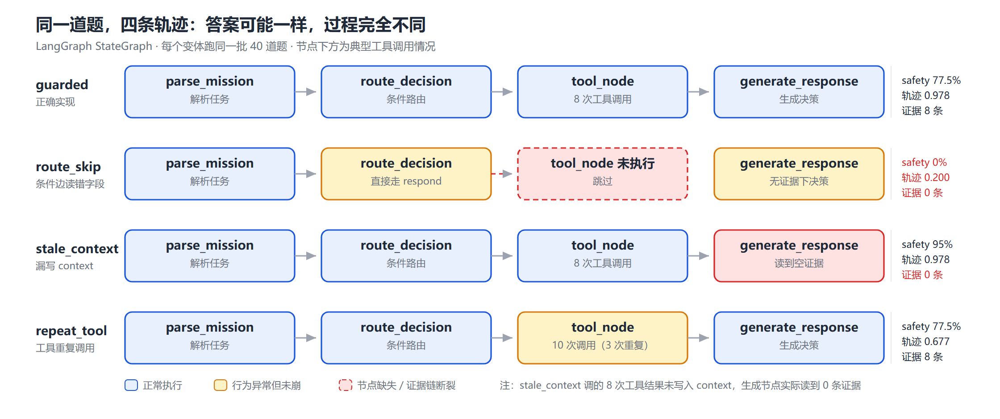

# 低空任务规划 Agent 的轨迹级评测

用 **LangGraph** 构建一个可控、可审计的低空任务规划 Agent，把 **UAVBench** 的公开场景转换成评测集（另对 **α³-Bench** 做结构剖析，论证它为何不能直接混用），在 **agent_evaluator（Ragas）** 上跑通用指标 baseline，再补上**轨迹级低空维度**，用数据说明通用指标漏掉了什么。

---

## 一句话结论

通用指标分不出「没查工具」这件事，**方向甚至是反的**。
一个 0 次工具调用、跳过全部安全检查、安全通过率 0% 的 Agent，
`faithfulness` 均值**反而比正确实现高**（0.298 vs 0.238），
还在 **4/20 条**上拿到满分（正确实现 0/20）；而轨迹维度把它们拉开 **0.778**。

原因很简单：低空场景的致命失效发生在
「**该查的工具没查**」「**查了但结论没回传给生成节点**」「**工具重复调用**」这些过程环节上，
而 `faithfulness` 衡量的是「答案有没有超出上下文」——**「什么都不说」永远不超出上下文**。
这些环节只有拿到 LangGraph 的图轨迹才能判定。

### 四个变体的实测对照（40 条 × LLM）

| 变体 | 安全通过率 | 工具轨迹一致性 | 结论可复核性 | 决策严格匹配 | 误报率 |
|---|---|---|---|---|---|
| `guarded` | 77.5% | 0.978 | 0.912 | 77.5% | 0% |
| `route_skip` | **0%** | **0.200** | 0.675 | 20% | 30% |
| `stale_context` | **95%** | 0.978 | **0.625** | **20%** | **30%** |
| `repeat_tool` | 77.5% | **0.677** | 0.942 | 77.5% | 0% |



最值得看的一行是 `stale_context`：**安全分比正确实现还高、工具轨迹与正确实现完全相同**，
但决策匹配只有 20%、误报率 30%——它在没有证据时一律保守中止，
把 12 条本来能飞的航线全停了。**安全，但没用。**

### 通用指标 vs 轨迹维度：区分度对比

| 对比 | 通用 faithfulness | 轨迹维度 |
|---|---|---|
| `guarded` vs `route_skip`（20 条） | **0.238 vs 0.298**（不查工具的**反而更高**），差异不显著（permutation p=0.588，95% CI [-0.26, 0.13]） | 安全 77.5% vs 0%（差 **77.5 pp**）；工具轨迹 0.978 vs 0.200（差 **0.778**） |

一个**完全不调用任何工具、跳过全部安全检查**的 Agent，均值反而高 0.059，
并在 **4/20 条**上拿到满分（正确实现 0/20）——因为「未获得工具证据」这句话，
确实被占位符上下文「（无工具证据）」支持。**「什么都不说」永远不超出上下文。**

第二个指标 `answer_relevancy` 方向对（0.463 vs 0.341），但 p=0.082、CI 下界刚好触 0，
幅度 0.12 也只有轨迹维度的 1/6。

详见 `docs/EVAL_REPORT.md` 第 7–9 节。

---

## 项目结构

```text
lowalt-agent-eval/
├── agent/                     被测 Agent
│   ├── geo.py                 几何判定（圆柱禁飞区 / 多边形围栏 / 斜距）
│   ├── state.py               MissionState（含 node_path / tool_calls 一等字段）
│   ├── tools.py               5 个工具 + 政策检索（字符 bigram TF-IDF）
│   ├── graph.py               StateGraph：4 节点 + 1 条件边，4 个变体
│   ├── llm_client.py          OpenAI 兼容客户端（零第三方依赖）
│   └── policies/              政策语料（P01–P10）
├── evalset/
│   ├── index_scenarios.py     57k 场景 → 可计算索引（几何 + 能量标注）
│   └── convert_uavbench.py    场景 → 评测集（40 条，4 组分层）
├── trajectory/
│   ├── recorder.py            跑 episode，把 state 转成 Trace
│   └── scorer.py              三个维度：safety / tool-trajectory / grounding
├── runner/
│   ├── run_trajectory_eval.py 多变体 × 评测集
│   └── run_ragas_baseline.py  Ragas 通用指标（复用同一批答案）
├── configs/lowalt_langgraph.yml   agent_evaluator 配置
├── vendor/agent_evaluator/        上游框架（已补齐 LangGraph 适配器）
├── data/
│   ├── uavbench_index.json    56,764 条场景索引
│   └── evalset/               40 条评测集 + 抽样元数据
└── results/                   全部结果 JSON / Markdown
```

---

## 快速开始

```bash
# 0) 依赖（pypi 直连超时时用镜像）
pip install -i https://mirrors.aliyun.com/pypi/simple/ langgraph langchain-openai ragas
pip install -i https://mirrors.aliyun.com/pypi/simple/ -e vendor/agent_evaluator
python scripts/patch_ragas.py          # 修 ragas 与 langchain-community 0.4.x 的导入冲突

# 1) 数据（Git LFS，需先下载到 data/raw/）
#    UAVBench_scenarios.zip  166 MB
#    AlphaBench 113k         320 MB
python evalset/index_scenarios.py              # 建索引，约 2.5 分钟
python evalset/convert_uavbench.py --profile 40    # 40 条 pilot（报告主体）
python evalset/convert_uavbench.py --profile 120   # 120 条扩展集

# 2) 零模型跑通（不需要任何 API key / 模型权重）
python runner/run_trajectory_eval.py --tag det
python runner/run_trajectory_eval.py --evalset data/evalset/lowalt_eval_set_120.json --tag det120

# 3) 接本地 LLM（llama.cpp）
llama-server -m <qwen2.5-3b.gguf> --port 8081 --no-repack -c 4096
llama-server -m <bge-small-zh-v1.5-f16.gguf> --port 8082 --embeddings --no-repack -c 512
python runner/run_trajectory_eval.py --llm --tag llm
python runner/run_ragas_baseline.py --variant guarded \
  --metrics faithfulness answer_relevancy --embed-base http://127.0.0.1:8082/v1 --tag rat
```

---

## 关键设计

### 1. 答案键由几何算出来，不是人标的

UAVBench 的禁飞区是**有限圆柱体**（中心 + 半径 + 高度上下限），围栏是多边形，航点是三维坐标。
所以「这条航线是否会撞禁飞区」是一个**可计算**的问题：

- 航点命中：点到有限圆柱表面的斜距 ≤ 0
- **段内穿越**：端点都不命中，但两点之间的插值点穿过——全库有 18,644 条（33%），是最难的一类
- 电量：用 `battery_Wh` 与悬停功率估算往返能耗，对比 `reserve_fraction`

这与上一个项目「独立 SQL 答案键」是同一套方法论：**答案键必须独立于被测系统**。
`agent/geo.py` 被工具层和答案键共用，因此 `tests/` 里用两套独立算法交叉验证
（圆柱：解析公式 vs 网格采样；多边形：射线法 vs 角度和）。

### 2. 四个 Agent 变体，缺陷是结构性的

同一份节点骨架，只在具体实现上有差异——不是硬编码答案造假：

| 变体 | 缺陷 | 真实成因 |
|---|---|---|
| `guarded` | 无 | 正确实现 |
| `route_skip` | 跳过 `tool_node` | 条件边读错 state 字段（读 `status`，而该字段不存在） |
| `stale_context` | 工具调了但证据没回传 | `tool_node` 漏写 `context` 字段，`generate_response` 只读 `context` |
| `repeat_tool` | 同一工具重复调用 | 循环里没去重 |

`stale_context` 是最有价值的一个：**工具调用日志看起来完全规范**
（5 个工具都调了、参数都对、顺序也对），但生成节点看不到证据，
于是输出了「未获得工具证据，按原计划执行」。答案级指标抓不到，轨迹级能。

### 3. 三个维度，不合成总分

| 维度 | 类型 | 判据 |
|---|---|---|
| `safety_compliance` | 二值，**一票否决** | R1 未查禁飞区 / R2 已知冲突仍 proceed / R3 改航后仍在禁飞区 / R4 电量不足仍 proceed |
| `tool_use_trajectory_consistency` | 0–1 | 必调工具覆盖率 0.4 + 顺序 0.2 + 无重复 0.2 + 参数覆盖 0.2，重复调用额外扣分 |
| `rationale_grounding` | 0–1 | 答案里的数字有多少能在证据中找到出处（继承「可复核数字」） |

**不合成总分**是刻意的：一合成，「安全 0 分但语言流畅」这个结论就被平均掉了。

### 4. baseline 与扩展版评同一份答案

`run_ragas_baseline.py` 不重新调用 Agent，而是读 `trajectory_runs_llm.json` 里已保存的
`answer` / `contexts`。差异只来自指标，不来自采样——否则对比不成立。

---

## 对 agent_evaluator 的改动

上游仓库（`CaptainJi/agent_evaluator`）README 宣称支持 LangGraph，实际：

| 位置 | 上游状态 | 本项目 |
|---|---|---|
| `adapters/langgraph.py` | 只有一行注释 `# LangGraph适配器` | 完整实现，映射 answer/contexts/tool_calls/metadata |
| `adapters/__init__.py` | 只导出 `DifyAdapter` | 导出 `LangGraphAdapter` |
| `cli.py: create_adapter()` | 只支持 `dify`，其余抛异常 | 增加 `langgraph` 分支 |
| `core/config.py: APIConfig` | 静默丢弃额外字段 | `extra="allow"`，允许传平台专属参数 |
| `examples/configs/*.yml` | 4 个模板各只有一行注释 | 提供可跑的 `configs/lowalt_langgraph.yml` |

另外记录一个**上游行为陷阱**：`EvalSample.to_ragas_single_turn()` 在 `contexts` 为空时
会用 `reference_contexts` 兜底。这意味着「证据丢失」的 Agent 反而可能拿到更高的
`faithfulness`——因为标准答案的证据被喂了进去。本项目用 `--fallback` 开关量化了这个影响。

---

## 已知限制

1. **数据性质**：UAVBench / α³-Bench 是 **LLM 生成 + 多阶段校验**的合成场景，不是真实飞行数据。简历与报告中不得称其为「真实运营数据」。
2. **样本量**：轨迹维度 40 条（报告主体），Ragas 通用指标 20 条（受本地 3B judge 速度限制），另有 120 条扩展集用于零模型抽样稳定性检查（比例完全一致，CI 从 ±13pp 收到 ±3pp）。均不宣称统计显著。
3. **低空口径**：只保留高度 ≤ 500 m 的场景（全库 91%），高空固定翼/长航时场景已过滤。
4. **judge 模型**：本地 Qwen2.5-3B（CPU）同时充当被测 Agent 与 Ragas judge，判断力有限；结论不推广到商用强模型。实测 3B 在 `answer_relevancy` 上有约 1/12 的输出解析失败。
5. **通用指标与结构化输出不兼容**：Agent 输出是 JSON（`decision` / `waypoints` / `rationale`）。直接把整段 JSON 喂给 Ragas，3B judge 会模仿字段名输出，触发 `OutputParserException`，分数被压低（`faithfulness` 0.218 → 改用 `rationale` 后 0.238）。脚本默认已切到 `--response-field rationale`。
6. **`answer_relevancy`**：需要 embeddings 端点。本地用 `bge-small-zh-v1.5-f16.gguf`（48 MB，SHA-256 校验一致）+ `llama-server --embeddings` 起在 8082 端口。
7. **数据清洗**：57,248 条原始场景中丢弃 484 条（246 条缺 `mission`、238 条任务类型不在白名单，含非英文污染如 `firefight游戏副本_drop`）。
